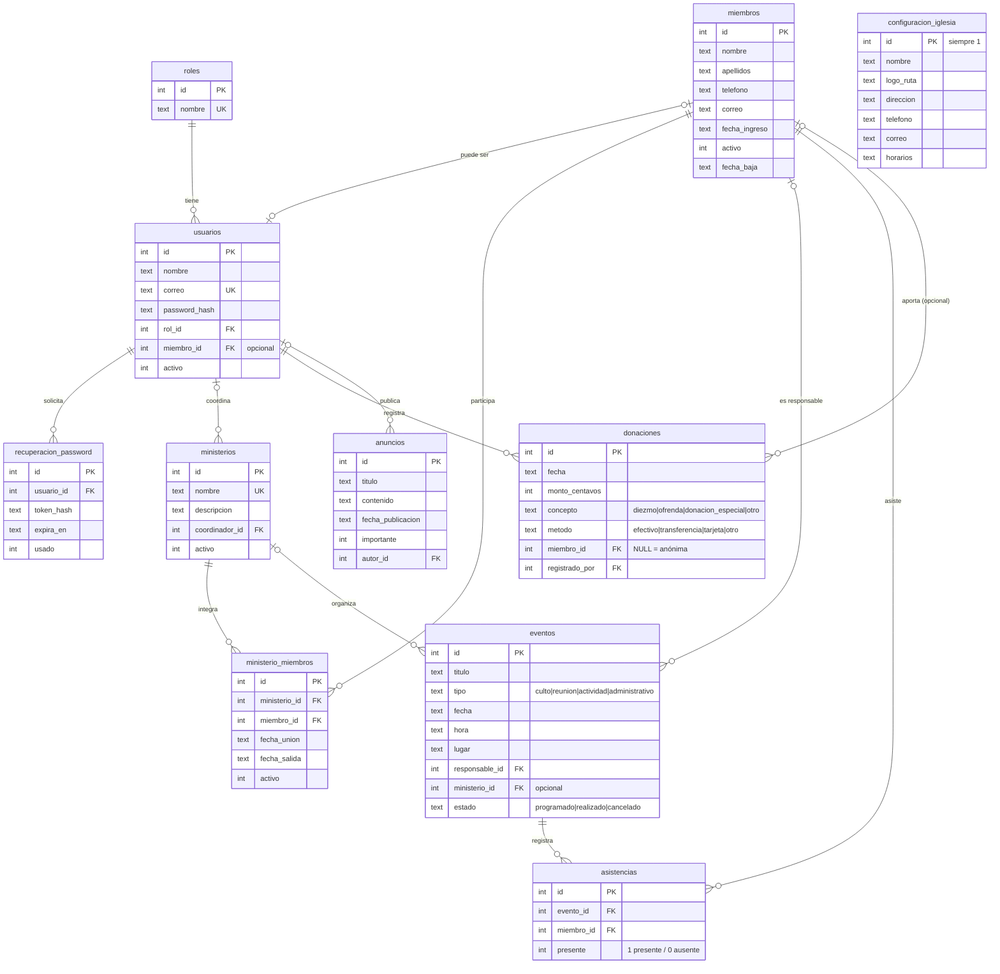

# Diagrama entidad-relación

GitHub dibuja este diagrama automáticamente. La definición exacta de cada campo está en [`src/db/schema.sql`](../src/db/schema.sql).

## Vistas para panel y reportes

| Vista | Uso | Acceso |
|---|---|---|
| `v_indicadores_panel` | Tarjetas del panel principal | Todos |
| `v_asistencia_por_evento` | Reporte de asistencia (semanal / mensual con `semana`, `mes`) | Admin, Pastor, Secretario |
| `v_participacion_ministerio` | Integrantes, actividades y % de asistencia por ministerio | Admin, Pastor, Secretario |
| `v_ingresos_mensuales` | Ingresos por mes, concepto y método | **Solo Admin y Tesorero** |
| `v_movimiento_miembros` | Altas y bajas por mes | Admin, Pastor, Secretario |
